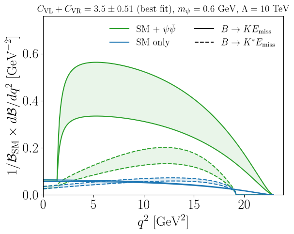
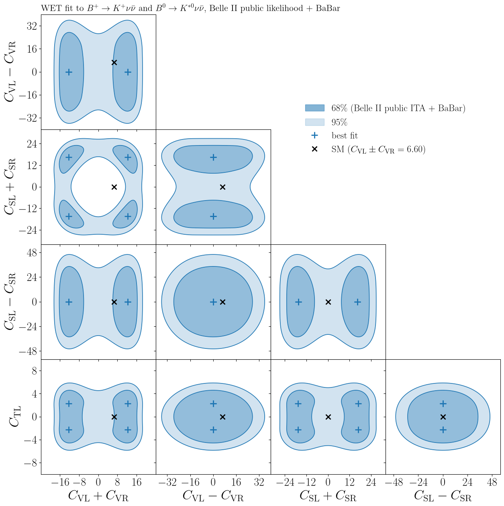

# bk-invisible-fits: light new physics fits to $B \to K^{(*)} E_{\rm miss}$ data

Belle II has found evidence for $B^+ \to K^+ \nu \bar{\nu}$, with a rate 2.7σ above the Standard Model (SM) prediction. bk-invisible-fits tests
whether new light invisible particles can explain it. It fits new-physics (NP) scenarios to the
binned $q^2$ spectra of Belle II's $B^+ \to K^+ E_{\rm miss}$ (inclusive tag) and BaBar's $B^0 \to K^{*0} E_{\rm miss}$,
together with LEP's bound on $B_s \to \rm inv$. The $q^2$ spectrum separates the scenarios, since
each kind of particle and coupling gives a different shape.

The scenarios are:

- a light scalar, vector, fermion or spin-3/2 particle, produced singly ($B \to K X$) or in
  pairs ($B \to K X \bar{X}$) through the effective operators in [docs/operators.md](docs/operators.md);
- the weak effective theory (WET) of $B \to K^{(*)} \nu \bar{\nu}$, with vector, scalar and tensor couplings.
  The vector couplings include the SM, so their interference with it is included.

The code computes the branching fractions and the binned signal predictions of each
experiment, including the Belle II $q^2$ smearing, form factor and efficiency uncertainties,
and fits them with binned Poisson likelihoods. Belle II's public likelihood
([arXiv:2507.12393](https://arxiv.org/abs/2507.12393)) is also implemented, and every fit can use either.

<p align="center">
   K and B -> K* spectra for the SM and for the SM plus a light fermion pair at its best-fit coupling">
  
</p>

Left: $B \to K$ and $B \to K^*$ spectra, normalised to the SM, for the SM and for the SM plus a
light Dirac fermion pair $\psi\bar{\psi}$ ($m_\psi = 0.6$ GeV) at its best-fit coupling. The bands are the form
factor and coupling uncertainties (notebook 05). Right: the WET couplings fitted to Belle II's
public likelihood and BaBar; each panel profiles over the other three couplings (notebook 04).

## References

The code is based on these papers:

- P. D. Bolton, S. Fajfer, J. F. Kamenik and M. Novoa-Brunet, *Signatures of light new
  particles in $B \to K^{(*)} E_{\rm miss}$*, [arXiv:2403.13887](https://arxiv.org/abs/2403.13887).
  The likelihoods of Belle II and BaBar (its appendix describes the BaBar inputs).
- P. D. Bolton, S. Fajfer, J. F. Kamenik and M. Novoa-Brunet, *Impact of new invisible
  particles on $B \to K^{(*)} E_{\rm miss}$ observables*, Phys. Rev. D 112, 035010 (2025),
  [arXiv:2503.19025](https://arxiv.org/abs/2503.19025). The pair-production scenarios and
  the combined fits.
- P. D. Bolton, J. F. Kamenik and M. Novoa-Brunet, *Dark light shining on $B \to K^{(*)} E_{\rm miss}$*,
  [arXiv:2512.16999](https://arxiv.org/abs/2512.16999). The light vector boson scenario.

If you use bk-invisible-fits, please cite these papers. The experimental inputs are from:

- Belle II, *Evidence for $B^+ \to K^+\nu \bar{\nu}$ decays*, Phys. Rev. D 109, 112006 (2024),
  [arXiv:2311.14647](https://arxiv.org/abs/2311.14647);
- Belle II, *Model-agnostic likelihood for the reinterpretation of the $B^+ → K^+\nu \bar{\nu}$
  measurement at Belle II*, Phys. Rev. D 112, 092016 (2025),
  [arXiv:2507.12393](https://arxiv.org/abs/2507.12393) (the public likelihood);
- BaBar, *Search for $B \to K^{(*)}\nu\bar{\nu}$ and invisible quarkonium decays*, Phys. Rev. D 87, 112005
  (2013), [arXiv:1303.7465](https://arxiv.org/abs/1303.7465).

Their sources and the way they were obtained are in the READMEs of
[data/BtoKEmiss](data/BtoKEmiss/README.md) and [data/BelleII_public](data/BelleII_public/README.md).
The Belle II (2023) and BaBar inputs were digitised from the figures of these publications.

## Installation

The project uses [uv](https://docs.astral.sh/uv/) and Python 3.14:

```sh
uv sync            # creates .venv with the package (editable) and the dev tools
uv run pytest      # runs the tests (about 20 s)
```

The experimental inputs and form factors are in `data/`. To use data stored elsewhere, set
the environment variable `LIGHTS_DATA_DIR` to that directory.

The Python package is called `lights` (`import lights`).

## Documentation

The [user guide](docs/guide.md) covers:
- **usage**, with examples of the models, fits and scans;
- **the method**: the likelihoods, Belle II's public likelihood, interference with the SM, and slices vs profiles;
- **the package layout**, the notebooks and the scripts.

## License

MIT; see [LICENSE](LICENSE). The data in `data/BelleII_public` is CC0 (HEPData).
